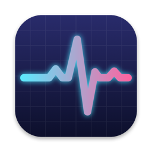

<div align="center">



# Pulse

**Tes limites Claude, ChatGPT, Gemini et Copilot, d'un coup d'œil dans la barre des menus.**

[](https://github.com/latifcodess/Pulse/releases/latest)


[**⬇︎ Télécharger**](https://github.com/latifcodess/Pulse/releases/latest) · [Installation](#-installation) · [Fonctionnalités](#-fonctionnalités) · [Réglages](#%EF%B8%8F-réglages) · [Compiler soi-même](#%EF%B8%8F-compiler-depuis-les-sources)

</div>

---

## ✨ Fonctionnalités

- **Une puce par IA dans la barre des menus**, avec son logo et le pourcentage utilisé. Elle passe à l'orange puis au rouge à l'approche de la limite.
- **Un panneau détaillé au clic** : chaque limite (session, semaine, modèle…) avec sa barre, l'heure de réinitialisation (*« Réinitialisé à 17:00 · dans 2 h 15 »*) et une projection (*« Limite atteinte vers 15:40 »* ou *« Tiendra jusqu'au reset »*).
- **Projection** : Pulse mesure ta vitesse de consommation sur les 30 dernières minutes et te dit si la limite sera atteinte avant le reset.
- **Notifications** : limite au-dessus d'un seuil, bientôt atteinte, de nouveau disponible, session expirée. Chaque alerte ne se déclenche qu'une fois.
- **Widgets** pour le bureau et le centre de notifications : une IA au choix, ou toutes d'un coup.
- **Deux façons de se connecter** à chaque IA : son outil en ligne de commande déjà installé, ou ton compte directement dans Pulse.
- **Hors ligne**, les dernières valeurs connues restent affichées.
- **Mises à jour automatiques** : Pulse te prévient quand une nouvelle version sort et s'installe en un clic.
- **Discret** : pas d'icône dans le Dock, interface en français.

---

## 📦 Installation

### 1. Télécharger

Télécharge le fichier `Pulse-x.y.z.dmg` depuis la [**dernière release**](https://github.com/latifcodess/Pulse/releases/latest), ouvre-le, puis glisse **Pulse** sur le raccourci **Applications**.

### 2. Autoriser l'app au premier lancement

L'app est signée avec un certificat de développeur, mais **elle n'est pas notarisée par Apple** (ce qui demande un compte développeur payant). Au premier lancement, macOS va donc la bloquer avec un message du type :

> **« Pulse » n'a pas été ouvert**
> Apple n'a pas pu confirmer que « Pulse » ne contient pas de logiciel malveillant…

C'est normal, et ça ne se fait qu'une seule fois. Pour l'autoriser :

1. Clique sur **OK** (ou **Terminé**) pour fermer le message.
2. Ouvre les **Réglages Système** ( › Réglages Système…).
3. Va dans **Confidentialité et sécurité**.
4. **Descends tout en bas** de la page, jusqu'à la section **Sécurité**. Tu y verras la ligne *« Pulse » a été bloqué afin de protéger votre Mac*.
5. Clique sur **Ouvrir quand même**.
6. Confirme avec ton mot de passe ou Touch ID, puis clique encore sur **Ouvrir quand même** dans la fenêtre qui s'affiche.

L'app s'ouvre, et macOS ne posera plus la question.

<details>
<summary>Alternative pour les habitués du Terminal</summary>

Cette commande retire le marqueur « téléchargé depuis Internet » de l'app, ce qui évite le blocage :

```sh
xattr -dr com.apple.quarantine /Applications/Pulse.app
```

</details>

### 3. Connecter tes IA

Les puces apparaissent dans la barre des menus. Pour chaque IA qui affiche **non connecté**, clique sur la puce › ⚙️ pour ouvrir ses réglages, puis choisis une **méthode** (voir le tableau ci-dessous).

Accepte aussi les **notifications** quand macOS les propose, si tu veux les alertes.

C'est prêt 🎉

---

## 🤖 IA prises en charge

Pour chaque IA, deux méthodes au choix :

- **l'outil officiel en ligne de commande**, s'il est déjà connecté sur ton Mac : Pulse lit ses identifiants, **sans jamais les copier ni les modifier** ;
- **ton compte, connecté directement dans Pulse**, si tu n'as pas l'outil.

| IA | Avec l'outil en ligne de commande | Avec ton compte dans Pulse |
|---|---|---|
| **Claude** | Claude Code : `claude`, puis `/login` | Compte claude.ai, dans une fenêtre de Pulse |
| **ChatGPT** | Codex CLI : `codex login` | Compte ChatGPT, dans une fenêtre de Pulse (avec ton e-mail) |
| **Gemini** | Gemini CLI : `gemini`, puis « Login with Google » | Compte Google, dans ton navigateur |
| **Copilot** | GitHub CLI : `gh auth login` | Compte GitHub, avec un code à saisir sur github.com |

> 🔒 Les secrets que Pulse enregistre lui-même (cookies de session, tokens des comptes connectés dans Pulse) sont rangés dans le **Trousseau** de macOS, jamais dans un fichier.

---

## 🖱️ Utilisation

| Où tu cliques | Ce qui s'affiche |
|---|---|
| **Une puce** dans la barre des menus | Le panneau de l'IA : ses limites, les heures de reset et la projection |
| **Une autre puce** | Son panneau remplace le précédent |
| **⟳** dans le panneau | Actualise tout de suite |
| **⚙️** dans le panneau | Les réglages de cette IA |
| **Pulse x.y** en bas du panneau | La mise à jour disponible |

> 💡 **Ajouter un widget** : clic droit sur le bureau › **Modifier les widgets…**, cherche **Pulse**, puis choisis *« Pulse — une IA »* (petit) ou *« Pulse — toutes les IA »* (moyen). Pour changer l'IA du petit widget : clic droit dessus › **Modifier**. Les données de plus de 15 min s'y affichent en grisé.

---

## ⚙️ Réglages

Ouvre les réglages avec le bouton ⚙️ d'un panneau. Les changements s'appliquent immédiatement.

**Onglet de chaque IA**

| Réglage | Effet |
|---|---|
| **Suivre** | Affiche ou retire la puce. Sans suivi, Pulse ne fait plus aucune requête pour cette IA. |
| **Méthode** | L'outil en ligne de commande, ou ton compte connecté dans Pulse. |
| **Valeur affichée** | La 1re limite, la 2e, ou les deux dans la puce. |
| **Pourcentage** | Le pourcentage utilisé ou restant. |
| **Actualiser toutes les** | De 30 s à 10 min. |
| **Orange / rouge au-delà de** | Les seuils de couleur de la puce, du panneau et du widget. |

**Onglet Général** : ouverture au démarrage de la session, IA suivies, recherche automatique des mises à jour.

**Onglet Alertes** : active, modifie ou ajoute des alertes.

| Alerte | Quand |
|---|---|
| **Limite au-dessus d'un seuil** | La limite choisie dépasse le seuil (80 % et 90 % par défaut). |
| **Limite bientôt atteinte** | Au rythme actuel, la limite sera atteinte dans moins de 30 min. |
| **De nouveau disponible** | Une nouvelle fenêtre commence après une limite presque atteinte. |
| **Session expirée** | La connexion à une IA a expiré. Un clic ouvre ses réglages. |

---

## 🔄 Mises à jour

Pulse vérifie les [releases GitHub](https://github.com/latifcodess/Pulse/releases) :

- **à chaque ouverture de l'app**, y compris au démarrage de la session ;
- **une fois par jour** ensuite ;
- **à la demande**, avec le bouton **Rechercher maintenant** (Réglages › Général).

Quand une nouvelle version existe, une fenêtre affiche les nouveautés et propose trois choix :

- **Installer et relancer** : Pulse télécharge la nouvelle version, vérifie son empreinte, sa signature et sa compatibilité avec ton Mac, se remplace et se rouvre tout seul.
- **Plus tard** : la fenêtre reviendra au prochain lancement.
- **Ignorer cette version** : plus de fenêtre automatique pour cette version.

Les mises à jour installées depuis Pulse ne déclenchent pas le blocage de macOS décrit plus haut.

---

## 🛠️ Compiler depuis les sources

**Prérequis** : macOS 15 ou plus récent, Xcode, [XcodeGen](https://github.com/yonaskolb/XcodeGen) (`brew install xcodegen`) et [Rust](https://rustup.rs) avec les deux cibles macOS :

```sh
rustup target add aarch64-apple-darwin x86_64-apple-darwin
```

Puis :

```sh
git clone https://github.com/latifcodess/Pulse.git
cd Pulse
./scripts/build.sh        # → build/Pulse.app (Apple Silicon + Intel)
open build/Pulse.app
```

`build.sh` génère le projet Xcode, compile le cœur Rust et l'app en Release, puis copie l'app dans `build/`.

```sh
cd core && cargo test     # tests du cœur Rust
```

> Le projet Xcode est généré à partir de [`project.yml`](project.yml). Modifie ce fichier plutôt que les réglages dans Xcode, puis lance `xcodegen generate`. Pour signer avec ton propre compte Apple (il en faut un pour l'App Group du widget), connecte-le dans Xcode › Réglages › Comptes, puis remplace `DEVELOPMENT_TEAM` dans `project.yml` par ton Team ID.

### Publier une nouvelle version

1. Augmente `MARKETING_VERSION` (et `CURRENT_PROJECT_VERSION`) dans [`project.yml`](project.yml).
2. Lance `./scripts/package.sh` : il produit dans `build/release/` le DMG et son empreinte, `Pulse-x.y.z.dmg` et `Pulse-x.y.z.dmg.sha256`.
3. Fais le commit et le push, puis crée une release GitHub avec le tag **`vx.y.z`**, des notes de version (elles s'affichent dans Pulse) et **les deux fichiers**.

Une release sans fichier `.sha256` est refusée par Pulse. Les brouillons et les préversions sont ignorés.

---

## 🧩 Comment ça marche

```
Pulse.app                      ← app de barre des menus (Swift)
├── Contents/MacOS/Pulse       ← inclut le cœur Rust (réseau, alertes, projection)
└── Contents/PlugIns/
    └── PulseWidget.appex      ← widget (lit seulement les données partagées par l'app)
```

| Dossier | Contenu |
|---|---|
| [`core/`](core) | Cœur en **Rust** : requêtes aux services, lecture tolérante des réponses, projection, moteur d'alertes, mises à jour. Exposé à Swift par [UniFFI](https://mozilla.github.io/uniffi-rs/). |
| [`app/Sources/Pulse/`](app/Sources/Pulse) | App en SwiftUI + AppKit : barre des menus, panneaux, réglages, notifications, connexions aux comptes |
| [`app/Sources/PulseWidget/`](app/Sources/PulseWidget) | Widget **WidgetKit** : petit et moyen |
| [`app/Sources/Shared/`](app/Sources/Shared) | Format des données partagées entre l'app et le widget |
| [`scripts/`](scripts) | Build, DMG, icône |

- Le **cœur Rust** fait tout ce qui se teste sans interface : il interroge les services, et un champ manquant dans une réponse donne « indisponible », jamais un crash.
- Après chaque actualisation, l'app écrit un petit fichier JSON dans un **App Group** ; le widget, **sandboxé**, ne lit que ce fichier, sans réseau ni Trousseau.
- L'ouverture au démarrage repose sur `SMAppService`.

> ⚠️ Pulse utilise des API internes, non documentées, de ces services. Elles peuvent changer sans préavis : une limite affichée « indisponible » vient souvent de là.

---

## ❓ Dépannage

<details>
<summary><b>Une IA affiche « non connecté »</b></summary>

Ouvre ses réglages (⚙️ dans son panneau) et regarde la **méthode** :

- **Outil en ligne de commande** : l'outil n'est pas installé ou pas connecté. Le panneau indique la commande à lancer dans le Terminal (par ex. `codex login`).
- **Compte** : clique sur **Se connecter…**.

</details>

<details>
<summary><b>Une IA affiche « expiré » ou « indisponible »</b></summary>

- **Expiré** : la connexion n'est plus acceptée. Reconnecte-toi avec l'outil (Claude Code, Codex, `gemini`, `gh auth login`) ou dans les réglages de Pulse.
- **Indisponible** : le service a répondu quelque chose d'inattendu. Réessaie plus tard avec ⟳ ; si ça dure, le service a peut-être changé son API.

</details>

<details>
<summary><b>macOS demande l'accès au Trousseau</b></summary>

Pulse lit le token de Claude Code et ses propres secrets dans le Trousseau. Clique sur **Toujours autoriser** pour ne plus avoir la question.

</details>

<details>
<summary><b>Le widget n'apparaît pas dans la liste</b></summary>

1. Vérifie que Pulse est dans le dossier **Applications** et qu'il a été ouvert au moins une fois.
2. S'il y a plusieurs copies de Pulse sur ton Mac, garde uniquement celle d'Applications.
3. Ferme puis rouvre la galerie des widgets (clic droit sur le bureau › **Modifier les widgets…**).

</details>

<details>
<summary><b>macOS indique que l'app ne peut pas être ouverte</b></summary>

Suis l'étape [Autoriser l'app au premier lancement](#2-autoriser-lapp-au-premier-lancement).

</details>

<details>
<summary><b>Désinstaller l'app</b></summary>

1. Dans Pulse, Réglages › Général : désactive **Ouvrir Pulse au démarrage de la session**, puis clique sur **Quitter Pulse**.
2. Mets **Pulse.app** à la corbeille depuis le dossier Applications.
3. Facultatif : dans l'app **Trousseaux d'accès**, supprime les éléments nommés `ch.latifcodess.pulse` (les comptes connectés dans Pulse).

</details>

---

<div align="center">
<sub>Fait avec ❤️ en Swift et en Rust · Logos via <a href="https://simpleicons.org">Simple Icons</a> · Pulse n'est affilié ni à Anthropic, ni à OpenAI, ni à Google, ni à GitHub.</sub>
</div>
